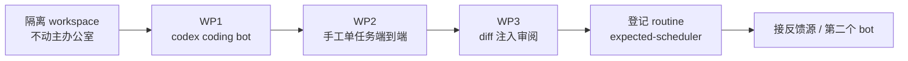

# 让 office 承担代码开发：执行方案（2026-11-21）

> 证据档：`RESEARCH-2026-11-21-lauren-tan.md`（T1–T13、§7）、`RESEARCH-2026-11-01-multi-agent.md`、
> `DESIGN-DECISIONS.md` §9/§10、`USE-CASES-2026-11-01.md`。
> 本文件只留**做法、验收、回滚、里程碑**；来源、数字、口径只改证据档，不在本文件转引精确值。
>
> 状态：**方案，未实施**。本轮没有新跑实验或压测，全部基于静态代码与文档核对。

## 0. 结论与目标

**结论：当前形态不适合直接做代码开发，但平台已有约一半零件。** 缺的不是模型能力，是
"bot 能产出代码 + 能交验证证据"这一段链路。

- **目标**：office 承担代码任务的外环（发现、分流、验收、开 PR）+ 受控内环（在 codex worktree 里写代码、
  跑机检、交 PR）。
- **非目标**：不全局放开 opencode 的 `bash`；不并行写同一个 repo；不自动 merge / push / deploy；不放开外发。
- **分工**：Grok Bot 式的外环归 office，写代码的执行层归 codex / CLI harness。这条分工来自 T9/T11/T13，见 §2。

## 1. 现状基线：已有零件 vs 真缺口

| 已有（代码强制） | 证据 | 缺口 / 备注 |
|---|---|---|
| `command` 判据：cmd.exe、cwd=worktree、5min、4000 字符截断 | `internal/team/task_verification.go:59-79,152-178`、`task_verification_shell_windows.go:29` | 由 **broker** 跑，不是 bot 自己跑；bot 侧仍无执行权 |
| coding bot claim 任务时自动切 `local_worktree` | `internal/team/broker_tasks_worktrees.go:108-114` | 当前没有任何 coding 实例（见下表） |
| 每任务独立 git worktree | `internal/team/worktree.go:132`（调研） | owner 级独占恒 false、跨 repo 无锁（`broker_tasks_worktrees.go:91`） |
| codex 三档：plan=read-only / execute=workspace-write / unsafe=bypass | `internal/team/headless_codex_runner.go:59-76` | 要按 bot 选，不能全局切 |
| PR 指令：`gh pr create` + 必须回帖真实 URL | `internal/team/prompt_builder.go:441-443`（`codingBotSlugs` 门控） | 只在 prompt 层，没有 routine 触发它 |
| reviewer 路由已算 `git diff --name-only` | `internal/team/broker_reviewer_routing.go:578-610` | diff 不进审阅 brief |
| 审阅回合落 `team/reviews/<id>.md`，干净上下文 | `internal/team/task_review.go:186-192,235-262` | 审的是交付文档，不是 patch |

**真缺口（阻碍代码开发的）**

| 缺口 | 证据 |
|---|---|
| opencode 侧 `bash: deny`、`webfetch: deny`、`task: deny` | `internal/team/headless_opencode_mcp.go:125-146` |
| 无 coding routine / playbook；`expected-scheduler.json` 只有 forex 日简报；live 无 `local_worktree` 任务 | `docs/office/expected-scheduler.json`；调研 3、4 |
| `StalledTurns` 不覆盖"从未启动"的任务 | `DESIGN-DECISIONS.md:344` |
| 审批卡与投递通道互锁（J2-2 已修，需回归） | `TODO-NEXT.md:34` |
| turn 15m / 10m 上限；同输入重放 41 次的历史 | `headless_codex.go:124,134`（调研）；`DESIGN-DECISIONS.md:436` |
| 显式反面清单："用多 agent 硬啃长程编码" | `DESIGN-DECISIONS.md:1065` |

## 2. 目标形态有先例：用 Grok Bot 开发 Grok Bot

这一节回答"我们想做的事有没有人真做过"。答案是有，而且就在本次调研对象身上。

### 2.1 她实际跑的几条闭环

| 闭环 | 怎么跑 | 来源 |
|---|---|---|
| 发布后自测 | 每次发版 → Grok Bot 自动开 Cursor project → 像真实用户一样 fuzz 整个 build → 为 bug 开修复 PR → 自动合并 | T5，演讲原话 |
| 反馈 → 修复 | Slack 反馈 → 建工单 → cloud agent 复现 → 修 → 另一个 agent 模拟用户验证 → 通知她；1 小时否决窗口 | T12（三级整理）+ T10（Coursiv） |
| 个人编码入口 | 只跟 Chief of Staff 说话 → Macha（tech lead）拆解 → 工程 bot → 各自开 Cursor Cloud Agent；PR 回来 bot 先审，有时合了她才看 | T9，访谈逐字稿 |
| pstack 自己的 eval | 在 Grok Bot 里跑不同模型 sub-agent 试同一个 skill 改动，目标真达成才接受 | T9 |
| 产品本身的产出 | 七周从零到上线；她曾在 200 条 Slack 消息里和同事+bot 端到端做完一个功能，没开代码编辑器 | T6 / i10X |

### 2.2 关键消歧：不是 Grok Bot 自己写代码

官方 [Grok Bot 101](https://x.ai/bot/guides/grok-bot-101)（作者 Matt Palmer，是她同事，**不是 Lauren**）：

> Grok Bot is not writing the code. It is creating the same prompts I would, then sending them to
> a specialized coding harness that lives inside Cursor.

所以准确说法是：**她用 Grok Bot 管理"开发 Grok Bot"这件事**——收上下文、保留原始报告、派活、验证、
决定合不合；执行层是 Cursor 里的 coding harness。这正是本方案 §0 的分工来源。

### 2.3 对她而言的前提，正是我们的缺口

1. **能跑产品的 verification skill + feature map**——她能开云桌面、抓 trace、模拟真实用户；我们 bot 连 `bash` 都被禁。
2. **发布/反馈事件源**——她的 routine 监听 Slack / X / GitHub；我们只有 forex 日简报一个 routine。
3. **独立 verifier + 否决窗口**——她有另一组 agent 复测；我们审阅 brief 连 diff 都没有。

**结论**：把"office 处理 gawkbot 自己的 bug 反馈"列为 **M4 之后的目标**，不从它起步。

### 2.4 场景性质：既有项目还是新项目

她在两类现场都做过：Cursor 3 Agent Window（既有产品里的新模块，第一周性能排查催生 verification skill）、
Grok Bot（新项目，但接手时已是"快而无护栏"的原型，用 600+ 重构 PR 重建 Dune）、pstack（从失败模式增量长出）。

她的判断反直觉：**绿地 vibe-coded 原型比大厂老代码库更危险**——老代码库本来就带着为大量工程师准备的护栏，
agent 受益（T7，约 30:31–33:34）。这对我们有利：gawkbot 已有 lint / CI / `go test` / worktree / 判据 / 审阅 / 漂移巡检，
属于"带护栏的既有仓库"，不是绿地。但**缺的是验证层**，这正是 WP3 要补的。

### 2.5 口径

11,000 PR / 0.5% revert / 227 贡献者全是团队自报；T12 是三级整理，1 小时否决窗口非逐字确认；
不同剪辑里 bot 编制互相矛盾。这些只说明规模，不能当质量或效率证明。

## 3. 四个工作包

### WP1 — coding bot 切 codex（不改全局 provider）

1. **不动 `llm_provider`**：主办公室当前是 opencode（`~/.wuphf/config.json`，运行时观察）；§9.1 禁 bash 的事故是全局理由，
   不要推翻（`DESIGN-DECISIONS.md:465`）。
2. 给单个 member 设 `ProviderBinding{Kind:"codex"}`：创建 / PATCH 入口 `broker_office_members.go:68,301,477-495`；
   模型解析 `broker_member_runtime.go:66-78`。
3. slug 必须在 `codingBotSlugs`（`mcp_config.go:21-30`：`eng/fe/be/ai/qa/tech-lead`）才能拿到 worktree 自动分配与 PR 指令。
   建议**新建 `coder` 并加入这张表**，避免污染现有角色。
4. 模式：plan 用 read-only；execute 用 workspace-write；`--dangerously-bypass` 只允许已确认的 local_worktree
   （`headless_codex_runner.go:64-67` 的注释就是为此写的）。
5. **验收**：隔离 workspace 内两次任务——①只读列文件：manifest 显示 provider=codex、无写；②改一个文件并跑
   `go test ./internal/team -run <单测>`：worktree 有 commit，主工作树 `git status` 无变化。
6. **回滚**：把 member provider 改回 opencode；全局 config 始终未动。

### WP2 — coding routine + ship-pr playbook

1. playbook 落 `team/playbooks/ship-pr.md`（路径约定 `broker_apps_starter_routine.go:165`），编译成 skill；
   内容只写"怎么交付"，不写"怎么判完成"。
2. 任务定义必须齐 Goal / Deliverables / Success criteria + `artifact_path`；verification 用 `command`，
   spec 指向包级测试（如 `go test ./internal/team -run TestX`），由 broker 在 worktree 跑。
3. **5min / 4000 字符是硬边界**（`task_verification.go:73-74`）：长测试拆包；超长输出靠落盘文件 + artifact 校验，
   不塞进 verification detail。
4. 新 job 要声明 `loop_step`（`DESIGN-DECISIONS.md:510`），否则 drift 报红。**先手工任务验证，通过后再登记 routine**，
   避免反复漂移。
5. **验收（端到端一次）**：人给一个小 bug → task 有 definition → `coder` claim 自动拿 worktree →
   改动 + 测试 exit 0 → `gh pr create` 输出真实 URL → artifact 落 `team/` → 审阅任务自动生成。
6. PR 创建涉及外发凭证，**第一次必须人在场**；之后才考虑放 routine。

### WP3 — 审阅 brief 注入 diff

1. 复用 `taskWorktreeDiff`（`broker_reviewer_routing.go:586-610`，5s 超时、基于 parent branch），
   但那是 `--name-only`；在 `reviewTaskDetails`（`task_review.go:238-262`）里另取内容。
2. 大小限制：建议 ≤2000 行 / 50KB，超出只给文件清单 + 关键 hunk + "完整 diff 在 worktree 路径"，别烧光审阅者上下文。
3. **别破坏干净上下文契约**（`task_review.go:235-237`）：只加 patch 与验收标准，
   不加作者推理、作者聊天记录。
4. **验收**：找一个已知修复，审阅回合必须给出至少一条具体代码级发现；反向验证——抽掉 diff 后审阅退化为只认 artifact 文本。

### WP4 — 门槛与稳定性

| 门槛 | 处理 | 证据 |
|---|---|---|
| 审批卡阻塞投递 | J2-2 已修，回归验证一次 | `TODO-NEXT.md:34` |
| `StalledTurns` 不覆盖"从未启动" | **必须修**，否则 coding 任务停在 breakdown 无人管 | `DESIGN-DECISIONS.md:344` |
| turn 15m / 10m | 任务切成一个 PR 一个 slice；`prompt_builder.go:433` 已有 "narrow to smallest runnable slice" 指令 | `headless_codex.go:124,134`（调研） |
| owner 独占恒 false | 先用调度约束保证"一个 repo 同时一个 coding 任务"，再考虑改代码 | `broker_tasks_worktrees.go:91`（调研） |
| token 成本 | 每任务 token 上限 + 同输入重试上限；验证阶段埋点 | `DESIGN-DECISIONS.md:436`；证据档 §6 |
| 成本对照 | 别引用她的 70% 当作我们的基线；本地无埋点 | 证据档 §6「验证 token 占比：无数据」 |

## 4. 里程碑与 go/no-go



**M2 的 go/no-go 五条**：`go test` exit 0 且输出落盘；PR URL 来自真实 `gh` 输出；审阅给出代码级发现；
main 无直接提交、无自动 merge；主办公室 `DRIFT: none` 且 watchdog 0 误报。任一不过就停在 M2，不推进 M4。

**M5（可选，§2 的先例）**：接 Slack / GitHub 反馈 → 建工单 → cloud agent 复现 → 修复 → 独立 verifier → 人否决窗口。
前置是 M3 的 diff 审阅 + WP4 的 token 埋点，缺一不可。

## 5. 风险与回滚

- **codex bypass 边界**：`--dangerously-bypass` 只在 local_worktree 用；禁止读写 wiki 根与 broker 鉴权路径——
  这正是 §9.1 事故的形态（`DESIGN-DECISIONS.md:465`）。
- **Windows**：`command` 走 cmd.exe（`task_verification_shell_windows.go:29`），路径与超时在隔离 workspace 实测。
- **gh 凭证**：第一次 PR 外发需人在场；不允许 bot 自行配置 token。
- **成本**：多 agent 15x token + 验证开销；先用单任务测出实际单价再谈并发。
- **回滚单元**：WP1 回滚到 member provider=opencode；WP2/WP3 是新增文件与 brief 字段，删掉即退；
  WP4 的 `StalledTurns` 修改按常规单测 + 反向验证走。

## 6. 更新触发

1. 主办公室 provider 或模型换代（`DESIGN-DECISIONS.md` 当前记 `opencode-go/hy4-flash-free`）；
2. M2 的 go/no-go 出现任何一条不过，回到对应 WP 重做，不得跳级；
3. `task_verification.go` 的 `command` 判据或 `headless_codex_runner.go` 的模式选择发生变化；
4. 本地拿到"验证 token 占比"埋点数据后，重估 M5 的成本门槛。

## 7. 实施记录（2026-11-21，首次尝试）

**M0 已完成**：`gawkbot workspace create coding-lab` → broker `:7910` / web `:7911`，
runtime home `C:\Users\ireke\.wuphf-spaces\coding-lab`。主办公室 `:7892` 未受影响
（lab `members=1`，主 `members=4`）。lab token 来自 `:7911/api-token`。

**WP1 配置层已完成**：lab 内 `POST /office-members` 创建 `eng`，
`provider.kind=codex`；`/office-members` 回显 `runtime.harness=codex`、`model=gpt-5.6-sol`。

**WP1 执行层未通过 — 阻断在 codex 鉴权**：探测任务 `CODIN-1`（`execution_mode=local_worktree`，
worktree 已创建）的回合对 `https://api.openai.com/v1/responses` 返回 `401 invalid_api_key`，
重试 1/2、2/2 均失败，任务已取消（`changed=true`），不再重投。

根因（代码已核，非猜测）：

1. `headless_codex_runner.go:554-567` 的 `prepareHeadlessCodexHome` **只把 `auth.json` 和 `.one/*`
   拷进隔离 home，不拷 `config.toml`**。lab 的 `~/.wuphf/codex-headless/config.toml` 只有 65 字节的
   `trust_level` 段，用户全局 `~/.codex/config.toml` 里的 provider / `base_url` 全部没有继承。
2. codex 因此回落到默认 `api.openai.com`，并使用从 `~/.codex/auth.json` 拷来的失效 key（`sk-pUIIk...`）。
3. 同时 `config.ResolveOpenAIAPIKey()`（`internal/config/config.go:875-883`）把环境里的
   `OPENAI_API_KEY` 通过 `headless_codex_runner.go:478-480` 注入子进程——同一个失效 key。
4. 用户全局 config 里配的三个本地/内网端点（`127.0.0.1:4000`、`127.0.0.1:20128`、
   `192.168.1.3:3000`）实测全部不可达（`curl` 返回 `000`），当前没有可切换的可用 provider。

**结论**：`runtime.harness=codex` 只证明绑定生效，不证明可调用；WP1 判定为**未通过**。
`codex login` 刷新 `~/.codex/auth.json`（或提供有效的 `WUPHF_OPENAI_API_KEY` /
可用 provider）之前，**不得建新任务**。修好后用同一条只读探测复验，不跳级。

**现状**：lab 留在运行态但空闲；可 `gawkbot workspace pause coding-lab` 或 `shred` 回收。
本轮未改仓库代码、未新增提交。

## 8. 最终路线：opencode 免费 hy（用户拍板，2026-11-21）

用户明确要求接入 opencode 免费 `hy4-flash-free`，不再走 codex 订阅路线。

- 中途验证过 magpie：本地网关 `127.0.0.1:3425/v1` 支持 Responses，`kiro/claude-sonnet-4.5`
  实测返回正常；因优先级变更，网关已停、探测任务已取消，**不作为最终方案**。
- 新建隔离 lab2：`:7912/:7913`，runtime 为 `opencode` / `opencode-go/hy4-flash-free`。
- 代码改动：`headless_opencode_mcp.go` 按 `codingBotSlugs[slug]` 给 coding bot 开 bash 白名单
  （`go test *`、`go build *`、`git status|diff|add|commit *`、`gh pr create *`），其余角色仍 `deny`；
  `webfetch` / `task` / wiki 的 deny 不变。新增单测
  `TestWriteHeadlessOpencodeMCPConfigBashPermissionByRole`；新测与原有并发配置测试均通过。
- **M1 通过（实测）**：任务 `CODIN-1` 在 worktree 内执行
  `go test ./internal/team -run TestWriteHeadlessOpencodeMCPConfigConcurrent -count=1`，
  `verification_result.pass=true`，detail 为 `ok github.com/nex-crm/wuphf/internal/team 0.383s`，
  任务进入 `review`。
- 清理：旧 codex lab 的 graceful / force pause 均超时，最终按端口定位 PID 45416 用 `taskkill /T /F` 结束；
  workspace 注册表仍显示 `stopping`（陈旧状态），可用 `gawkbot workspace doctor` 校正，不影响 lab2。
- 未提交：3 个文件的改动待提交；提交后后续 worktree 才基于已提交代码。

## 9. WP2 实测（2026-11-21，opencode hy）

- 任务 `CODIN-11`（`local_worktree`，带 Goal / Deliverables / Success criteria）由 lab2 的
  `eng` 承接。bot 在 worktree 内新增
  `internal/team/headless_opencode_permission_test.go`，断言非 coding 角色 `cos` 的
  `webfetch` / `task` 仍为 `deny`。
- `command` 判据实测 `pass=true`，detail `ok github.com/nex-crm/wuphf/internal/team 0.194s`。
- bot 只暂存自己的新文件，提交到任务分支 `wuphf-65f6c8a1-codin-11`（commit `1f4a836`）；
  **未 push、未建 PR**，主工作树 `git status` 为空。
- 人工审批后任务 `status=done`、`lifecycle_state=approved`，artifact 为上述测试文件。
- 该测试文件已并入主仓。仍未做：真实 PR（需人在场 + `gh auth`）、WP3 的 diff 注入审阅。

## 10. WP3：审阅 brief 注入 diff（2026-11-21）

- 代码：`task_review.go` 新增 `taskWorktreePatch`，对 `local_worktree` 任务取
  `git diff <parent>`，按 50KB / 2000 行截断；`reviewTaskDetails` 只把补丁作为 ```diff 段落注入。
  干净上下文契约不变：brief 里没有作者聊天、计划或推理（单测用 `AUTHOR_SECRET_REASONING` 反向验证）。
- 单测：`TestReviewTaskDetailsInjectsWorktreePatch`、`TestReviewTaskDetailsSkipsPatchForNonWorktree`、
  `TestTaskWorktreePatchNoWorktree`，连同既有审阅测试一起通过。
- 观察：lab2 的 `CODIN-11` 审批到 done 后**没有**自动生成 review 任务。代码线索是
  `queueTaskReview` 只在 `reachedDone` 分支触发（`broker_tasks_mutation_service.go:1830-1836`），
  审批路径未走该分支。记为 WP4 待修，也让 WP3 的 live E2E 暂时无法在该任务上验证。
- 未做：用新二进制/新 lab 跑一条会直接触发 review lane 的任务做端到端复核。

## 11. WP4 进展（2026-11-21）

- **已修**：审批到 done 不触发审阅车道。`broker_decision_packet.go` 在 terminal approve 分支补上
  `queueTaskReview`（与 distillation 并列），新增 `TestTerminalApproveQueuesCleanContextReview`；
  该路径通过单测后，WP3 的 diff 注入有了真实触发入口。
- 验证口径：相关测试（审阅、diff 注入、审批触发）与包编译均通过；`go test ./internal/team -count=1`
  全包跑 600s 超时未完成，不能算通过或失败，只按有界测试判定。
- 仍待：`StalledTurns` 未启动盲区、turn 15m/10m 与 owner 独占、token 埋点、真实 PR（需 `gh auth`），
  以及用新二进制/新 lab 跑 WP3 的 live E2E。

## 12. WP4 第二项：从未启动的任务（2026-11-21）

- 新增一次性 job `task_never_started_check`：任务进入 `in_progress` 且 `Ledger` 为空时布防（10 分钟），
  同一任务只布防一次。触发时若仍在可执行态、仍无 ledger、也无在飞回合，则发 `task_never_started`
  watchdog 告警 + 唤醒 owner + 记录 action，然后关闭 job；期间一旦有 turn、被阻塞、进入审阅或完成，
  就静默关闭。`StalledTurns` 的按轮计数不动。
- 单测 3 个：只布防一次、无 turn 时告警、有 ledger 时静默——均通过。
- 部署配套：`scripts/office/check-office-drift.ps1` 的 churn 过滤加入 `task-never-started-check`，
  否则新 job 会被误报为"清单外新 standing job"。
- 主办公室当前 `DRIFT: 1`（运行中二进制落后于 3 个 Go 提交：`5161f53` / `de71ceb` / `7a809c4`）。
  这是**未部署**的预期状态，不是回归；部署/重启主办公室需要单独决策。
- 仍待：部署决策、turn 15m/10m 与 owner 独占、token 埋点、真实 PR（需 `gh auth`）、WP3 live E2E。

## 13. 主办公室部署（2026-11-21）

- 从当前 HEAD 构建到 `C:/tmp/gawkbot-deploy.exe`；复用 `broker-watchdog.ps1` 的 `Restart-Broker`
  函数体生成临时部署脚本：按端口 7892 杀主进程树 → 覆盖 `gawkbot-fix.exe` → 用**原样 env 与重定向**启动。
  隔离 lab2（`:7912/:7913`）未受影响。
- 验证：`/health` 200、`provider_model=opencode-go/hy4-flash-free`、token 轮换为 `c1052…`、
  进程路径为仓库内 `gawkbot-fix.exe`（PID 49952，父 37736，无残留孤儿）。
- 唤醒链：`POST /messages` 到 `cos__human` 后 cos 回复 `OK`，投递正常。
- 漂移：`DRIFT: none`（16 个 job / 4 个计划任务 / 1 个运行中二进制）。
- 说明：临时部署脚本的 powershell 父进程因 `Start-Process` 持有 stdout 管道而超时 240s，
  但 `Restart-Broker` 已返回 `True` 且 broker 正常——是测量方式问题，不是部署失败。
