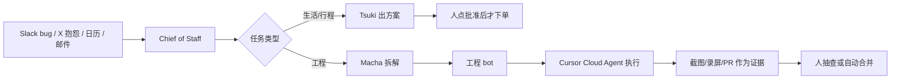

# Lauren Tan 的 agent 使用经验：外部调研记录（2026-11-21）

> 姊妹文档：`RESEARCH-2026-11-01-multi-agent.md`（回答"该不该并行"）、
> `USE-CASES-2026-11-01.md`（这套办公室具体接哪些活）。
>
> 本文件是**证据档**：来源、原文数字、口径、一手/二手标注、局限只放这里。
> 判据和落地状态留在 `DESIGN-DECISIONS.md` / `TODO-NEXT.md`；补来源只动本文件。
>
> 名字澄清：调研对象是 **Lauren Tan（@poteto，劳伦·谭）**，SpaceXAI / Grok Bot 工程师，
> 前 Cursor、Meta React Compiler 作者、Netflix EM。不是同名的律师/商人。

上一轮调研的问题是"多智能体值不值得做"；这一轮的问题是**"并行之前必须先建什么"**。
两者结论不冲突：上次说"写单线程、只读并行"，这次的对象把顺序说得更细——
**先让一个 agent 能验证自己的工作，再谈硬约束，最后才谈并行和自动合并**。

## 1. 方法与局限（先读这段再引用数字）

证据按可追溯程度分三级，下文每条来源都标了级别：

- **A 级 — 讲者原话，会议官方逐字稿/幻灯片**（T5）。能确认"她说了什么"，不能确认"事情真是这样"。
- **B 级 — 带时间戳的第三方笔记，附英文原句**（T2、T7）。逐字稿未核，但引文可定位到分钟。
- **C 级 — 二手转述**（T1、T3、T4、T8）。原文被墙、只有剪辑、或只有中文综述。

局限（引用任何数字前必须一起带）：

- X 原文返回 `x-unavailable`，T1 经 Leslie Li 的笔记转述；该作者明确说自己**没装 pstack、没用 Cursor 3 Agent Window**，只信她文章里的顺序，不信 slash-command 清单。
- 所有 PR 数、revert 率、性能数字**都是团队自报**，没有第三方复现、没有基线配置、没有 PR 大小分布、没有逃逸缺陷分母。
- 不同剪辑对 agent 编制的说法互相矛盾（10–20 / 参谋+PM+20+工人 / 参谋+3 经理+16 工人），**编制数字不可引**。
- 她本人明确承认在 AI lab、token 近乎无限，并说"不要照搬"；T7 还专门指出上传者标题加了演讲里没有的结论。
- T8 里引用的三篇学术论文统计（AI review 接受率、架构问题漏检率、企业 PR 吞吐量）是**二手转述，原文未读**，只能当方向，不可当精确值。
- 时效性：模型换代或价格结构变化后，"先验证再并行"的顺序不变，但"值多少钱"会变。更新触发见 §6。

## 2. 来源逐条

### T1 — How I Use Cursor（C 级）

| 项 | 内容 |
|---|---|
| 链接 | https://x.com/poteto/status/2058975157503570132 （原文不可读） |
| 转述 | https://leslieli.dev/notes/go-deep-first-pstack/ （Leslie Li，2026-08-27） |
| 发布 | Lauren Tan，**2026-05-25**；同日补一条 token 成本说明 |
| 可信度 | C（二手精读；引用的句子是她的，判断是转述者的） |

- 核心比喻："Agents are like new hires in a constant state of amnesia and idiocy." 规则、skills、tools、长期记忆只是对"团队记忆"的近似。
- 核心判断："**Naive parallelization just makes them write slop faster.**" 先 Deep First，宽度（`/arena`、`/interrogate`）排在 playbook 和验证之后。
- pstack 的中心是 `/poteto-mode`（按任务选 playbook），不是命令清单；按需工具有 `/how`、`/why`（跨 source control / issues / docs / chat / observability 的 MCP 查询）、`/architect`、`/arena`、`/interrogate`、`/tdd`、`/unslop`、`/reflect`、`/show-me-your-work`、`/automate-me`。
- **Benny 当时仍是 work-in-progress**（后文 T2 才给出可复现 bug 的例子）——转述者特别指出这一点，防止把 demo 当成品。
- 收尾条件：agent 不能端到端拥有问题（含验证）之前，不要自动化；并行不信任的 agent 只会浪费 token、增加 slop。
- 落地参考：pstack 源码 https://github.com/cursor/plugins/tree/main/pstack ；marketplace https://cursor.com/marketplace/cursor/pstack

### T2 — Codez 播客：How I Merged 1000 PRs in a Month with Agents（B 级）

| 项 | 内容 |
|---|---|
| 链接 | https://tobysguide.com/episodes/2026-08-24-lauren-tan-1000-prs-with-agents/ |
| 原视频 | https://x.com/Michaelzsguo/status/2092578668316864525 |
| 发布 | **2026-08-24**，60 分钟；第三方逐段笔记带时间戳与英文原句 |
| 可信度 | B |

章节与关键原话（时间戳为播客位置）：

| 时间戳 | 主题 | 可引用内容 |
|---|---|---|
| 5:07 | 信任曲线 | 早期盯少量 agent 的每份输出；五个月后 agent 自动合 PR。"I woke up today and there were like 20 PRs landed and I just reviewed them on main — and they were good." 警告：从不信任直接跳到开一千个 agent，纯烧 token |
| 7:52 | 验证是一号技能 | CPU trace、heap snapshot、iOS 模拟器等真实运行证据。"If you don't have a verification skill — **you are the verifier. You're the bottleneck.**" |
| 12:08 | feature map | 教 agent 每个功能是什么、UI 上怎么到达、快捷键、CDP 用的 DOM 属性；一张截图+三个问号的报告也能复现 |
| 21:05 | skill 的 eval | 协调者写 rubric；sub-agent 放在中性命名目录（agent 察觉被评测会改变行为）；换模型当 judge 防偏；`/loop` 爬山到满分；跑模型矩阵 |
| 27:47 | Benny | 云端 agent 开自己的桌面、跑同一套控制 skill 复现每条 bug；一例中复现后发现 main 上已修，省掉一次排查 |
| 40:57 | Dune | Electron 版 Next.js，为 agent 设计；CI 禁 `useEffect`、禁代码注释（99% 是"Lauren 说过别这么干"式无关历史）；依赖图检查进程边界 |
| 45:24 | 约束分层 | 架构约定 > 静态分析/CI > lint/编译器 > rules/skills/风格指南。"Every time you have to enforce an invariant by commenting on a PR, consider that a code smell." |

数字口径：上月 ship 1000 个 PR；当月 12 号接近 800。这是**个人自报吞吐量，不是效率倍数**。

### T3 — GrokBot workshop（C 级）

| 项 | 内容 |
|---|---|
| 链接 | https://www.youtube.com/watch?v=Zc07HI9Ppxk （约 59 分钟） |
| 转述 | https://aisocratic.org/news/lauren-tan-20-grokbot-agents-1000-prs-a-month-600-refactors-to-get-there （2026-08-26） |
| 可信度 | C（剪辑 + 二手；编制数字互相矛盾） |

- 真正解释这套系统的不是 agent 数量，而是 **600+ 个重构 PR**：先把 Grok Bot 从"agent 觉得怎么方便就怎么来"的原型重建到 Dune 架构，之后才敢让 agent 自行合并。
- 时间线自述：入职 Cursor 五个月，第一个月学代码库，次月约 1000 PR。
- 个人配置：Chief of Staff 作唯一入口，派给固定角色的专岗 bot；工具连接是账号级——连一次，现有和未来所有 bot 都能用；技能通过 "Teach a Task" 录屏演示教学；边界画在**可逆性**上（bot 起草邮件，外发需批准）。
- 同一个 vid 的剪辑对 bot 编制说法不一致 → 不可引。

### T4 — AMA：Agent 需分层（C 级）

| 项 | 内容 |
|---|---|
| 链接 | https://www.ababnews.com/news/2aedc1e0-0f7d-4e0d-b6a7-45e70b88db97 |
| 发布 | **2026-09-13**；无一手录屏链接，仅"来源：公开信息" |
| 可信度 | C（低到中） |

- 多个 bot 共享同一台底层机器，但**记忆数据和聊天记录互相隔离**。
- 复杂任务用"专岗小队"：Chief of Staff 是唯一任务入口。
- 分层链路：外环 bot 接 Slack / 邮件 / 日历 → 触发 Cursor 内环 → 拉起 cloud agents。外环 bot 本身不能随意换模型，派出的云端 agent 可以。
- 她的总结："先培养参谋型 Agent，再扩充执行型工人 Agent"；别让自己变成"催办员"。

### T5 — AI Engineer Code Summit：All Code Is Slop (Except Mine)（A 级）

| 项 | 内容 |
|---|---|
| 链接 | https://agents.conffab.com/aie-code-26/live/keynotes/sessions/1794420600.md （官方逐字稿 + 39 张幻灯片） |
| 视频 | https://www.youtube.com/watch?v=O_zcc6Xl12g （2026-11-14 上传） |
| 发布 | 演讲 **2026-11-11**，20 分钟 keynote |
| 可信度 | A（她说了什么可确认；数字仍是团队自报） |

**"每次纠正都变成确定性检查"**

- 幻灯片从 `setTimeout(() => release(id), 0)` 这个 quick fix 讲起；标题："comments are liabilities"，注释条形图从 65,824 降到 1,227。
- 原话："every time we correct our agents, it turns into one of these deterministic checks, or we think about how to categorically eliminate that problem … through better API design, through better architecture."
- Dune 的 lint 规则要求 agent **修根因**，不许打补丁；纠正累积到一定程度，code review "shrunk into looking at verification artifacts"，于是可以让 agent 合并大部分自己的 PR。

**验证从 runtime 扩到 formal**

- runtime verification：给 agent 人类开发者用的调试工具（CDP）。feature map = "a sitemap of all of the features … from the user's point of view"，给"左边栏那个东西"一个共享词汇。
- skill 里内嵌 custom CLI/driver，每次复用，**省 token 且可测试**。
- TLA+ 检查跨设备通知等主要用户流的状态机；Lean 证明自研虚拟化库不出现 flicker/jitter；Bombadil 做 UI property-based testing；新 skill `/statechart` 把状态机画出来，与视频/截图一起审。
- 她明确说形式化验证 "not a silver bullet"，只是环境里的另一层工具。
- 引 Cindy Sridharan：六个月前不信任 agent，如今**70% 日 token 花在验证上**；她说这与自己观察一致。

**数字与外环**

- 2026 年 10 月团队 ship **11,000 PR**；每天一个 stable release；约 **227 人**至少贡献一个 PR；revert 占比约 **0.5%** 且随量上升反而下降。
- 性能：冷启动 2,304 ms（5 月）→ 1,395 ms（−39%），输入/切会话等指标也变快。
- 发布后自动开一个 Cursor project，像真实用户一样 fuzz 整个 build，为发现的 bug 开修复 PR 并自动合并——她称之为 outer loop。
- 前提句："if your inner coding loop produces slop, then automating that loop just produces more slop." 先 lint、先清旧模式、先把验证做扎实，自动化是结果不是起点。

### T6 — YC Lightcone 访谈（C 级，经 i10X 整理）

| 项 | 内容 |
|---|---|
| 链接 | https://www.youtube.com/watch?v=JpJUHOe8bDo ；整理 https://i10x.ai/news/grok-bot-team-11000-pull-requests-lauren-tan |
| 发布 | **2026-11-14**（与 T5 视频同日） |
| 可信度 | C |

- Grok Bot 从第一行代码到上线用了七周。
- Roman Ugarte 说她个人"每月约 4,000 PR"——与 T5 的团队 11,000 是不同口径，**别混用**。
- 新瓶颈已经不是写代码，而是"团队对产品路线图的对齐"；他们的规矩："if something doesn't get internal product market fit, we don't ship it."

### T7 — EXEPERT：Lauren Tan on Trusting Coding Agents（B 级）

| 项 | 内容 |
|---|---|
| 链接 | https://www.exepert.com/blog/lauren-tan-trusting-coding-agents-verification |
| 原视频 | https://www.youtube.com/watch?v=EWSUvEyFwjc （第三方上传的 2026-08 直播） |
| 发布 | **2026-10-08** |
| 可信度 | B（逐分钟定位；作者明确声明上传者标题/描述加了演讲里没有的结论，只采信她在视频里说的） |

**两条容易被忽略的判断**

1. **危险的是绿地项目，不是大厂老代码库。** 大代码库本来就有为几千名不同水平工程师准备的护栏，agent 受益；真正危险的是没有任何约束的 vibe-coded 原型——agent 每次挑最省事的捷径，结构迅速缠到没人能理解。这正是 Grok Bot 的起点，也是 600 个重构 PR 的由来。
2. **成本与人的角色。** 她在 AI lab 有近乎无限的 token，明确说自己的做法不一定适合所有人；ROI 视角是"前期重构让普通 agent 也能写好代码"可能比人力便宜，但团队要小。角色比喻是 head chef：不再做每道菜，而是设计厨房、分配工位。另外她偏好每个 PR 只讲一件完整的事，Git 历史本身是上下文，便于定位回归和回滚。

### T8 — 掘金中文长文（C 级，综述）

| 项 | 内容 |
|---|---|
| 链接 | https://juejin.cn/post/7687032811338891302 |
| 发布 | **2026-09-19** |
| 可信度 | C（中文二手综述；她的数字可信，综述加的研究数据原文未核） |

- 补齐了文内没有的**操作细节**：Indirect Prompt（让 agent 读完整 Slack thread 后用自己的话复述问题，把理解错误拦在写代码前）；Plan Mode 批评（"长篇计划只给生产力错觉"）；23 条工程原则 + 22 个 playbook（Laziness Protocol、Subtract Before You Add、Attack the Premise、Prove It Works、Encode Lessons in Structure 等）。
- **Overnight Run 合约模板**：fresh worktree + 明确完成条件（可机械判定 pass/fail）+ "不要在提交前问我" + "卡住就停下写清原因"；每轮"最小变更 → 真实产物验证 → 提交 → 一行决策日志"；早上用 `/show-me-your-work` 出 TSV 决策日志，再用**异模型**读整夜 transcript 给"值得关注处"摘要。
- 与 Cursor 官方博客 "Towards self-driving codebases"（2026-02）交叉验证的七条中，一致的是：任务必须拆解、约束优于指令、给意图不给步骤、实证驱动、人负责判断；**分歧**是：Cursor 研究接受小错误率换吞吐并做事后 reconciliation，她的生产系统要求每个 PR 合入前独立通过验证；Cursor 大规模项目去掉中央协调者，她保留强协调者（`/poteto-mode`）。分歧根因是规模与系统性质（一次性构建 vs 持续生产）。
- ⚠️ 文中三处学术统计（AI review 31,073 条评论的接受/拒绝分布；LLM 对架构问题 87% 漏检；196,212 个 PR 的 2.09x 吞吐与 review 变慢）**均为转述，原文未读**，不得当精确值引用。

## 3. 综合：她说的"使用经验"到底是一条什么链

| 顺序 | 做法 | 证据 | 没做到会怎样 |
|---|---|---|---|
| 1 | 让一个 agent 能真实运行并观察产品（runtime verification + feature map） | T2 7:52/12:08、T5 | 人变成串行 verifier，并行无从谈起 |
| 2 | 每个失败模式 → skill → eval（rubric、盲测、跨模型 judge、`/loop`） | T1、T2 21:05 | 指令写着严格，行为没变；skill 随产品演化腐化 |
| 3 | 把重复纠正变成 lint/CI/架构，让最短路径等于正确路径 | T5、T2 45:24 | 代码库退化；review 里反复写同一条留言 |
| 4 | 本地先跑通，再上云端 agent 与自动化（内环 → 外环） | T2 27:47、T4、T7 | 跳级只是烧 token、放大 slop |
| 5 | 最后才谈 overnight run / 自动合并 / 千人级编排 | T5、T8 | 自动化一个坏循环，只会更快地产出坏代码 |

**反直觉但有一致证据的三点**

- 绿地原型比大厂老代码库更危险（T7）；护栏不是负担，是 agent 的脚手架。
- "禁用注释"不是文档风格偏好，而是因为注释不可强制执行、还会给 agent 提供不打补丁的借口（T5）。
- 验证本身成为最大 token 开销（T5 引 70%），这不是浪费，而是信任与并行的购买成本。

**不可直接移植的**：`useEffect` / 注释禁令是 React/Electron 场景解药；11,000 PR 的编制、token 预算、227 位贡献者规模都不具备可比性；"不要在提交前问我"与本仓库的审批卡、外发需批准语义直接冲突。

## 4. 对本仓库的映射（属推论，非她的原文）

| 她的做法 | 仓库现状（已核） | 判断 |
|---|---|---|
| 审验证产物而非 diff | `docs/office/OFFICE-RULES.md:28`：`DRIFT: none` + exit 0，"只贴看起来正常不算" | 方向已一致；可给第二行加覆盖度，首行被 watchdog 解析不能动 |
| 重复纠正变硬规则 | J3-2 watchdog 对 `decision` 态误报已固化成四态单测（`TestSchedulerQuietForTasksAwaitingReview` 等，`TODO-NEXT.md:271`） | 继续照此做；同类缺口见下节 |
| feature map（用户描述 → 可观察行为） | `docs/agents/agent-navigability.md` 偏代码/仓库导航 | 缺"用户语言 → UI/流程 → 证据"这一层 |
| 验证的 token 要量化 | skill 扫描缓存落盘，重启省约 1.4M token/次（`RUNTIME-API.md:651`） | 已有成本纪律；验证阶段占比尚无埋点 |
| Chief of Staff / 别当催办员 | broker + scheduler 派单，watchdog 可见化 + `task_retry` 2 分钟内重投（J2-4，`TODO-NEXT.md:43`） | 架构同构；接下来是"先养参谋、再扩工人"，不是增加 bot 数 |

**反面清单**：不要因为她的数字就放开无人值守合并；不要在验证闭环尚未稳定时扩并行；不要拿 PR 数当本项目的质量指标。

## 5. 候选场景与状态（对应 `TODO-NEXT.md` 开放项）

| 候选 | 依据 | 状态 | 卡在哪 |
|---|---|---|---|
| `DRIFT: none` 第二行承载覆盖度 | T5（审验证产物）；上次调研的覆盖度盲点 | 未做 | 首行被 watchdog 解析，格式不能动；先确认有无消费者解析第二行 |
| `StalledTurns` 覆盖"从未启动"的任务 | T5（硬约束 > 人肉发现）；已知缺口 `DESIGN-DECISIONS.md:344` | 未做 | 计数发生在 `AppendTaskLedgerEntry`，任务没跑过一轮就永远到不了 8 轮阈值 |
| feature map 补"用户描述 → 可观察行为" | T2 12:08、T5 | 未做 | 现有导航文档偏代码侧；需要一个真实模糊报告作为样例来定 schema |
| skill 级 eval（rubric / 盲测 / 跨模型 judge） | T1、T2 21:05 | 部分有 | `evals/` 现有 golden-case harness 只覆盖 extract/synthesis/query 三个 prompt；未涉及 skill 行为 |
| 重复 review 留言 → lint/CI 的转化率 | T5、T2 45:24 | 有先例，继续 | J3-2 是样板；需要一个计数口径才知道哪些留言还没转化 |
| Overnight run（"不要问我"） | T8 | **不做** | 与审批卡、外发需批准的边界直接冲突；可逆性界限不同 |

## 6. 什么时候该重读、怎么自测收益

满足任一条就重跑一轮调研并更新 §2：

1. 准备放开无人值守写操作或自动合并——**必须先重读 T5 的"don't automate a bad loop"整段**；
2. 主力模型换代或 provider 价格结构变化（当前 `opencode-go/hy4-flash-free`，见 `DESIGN-DECISIONS.md`）；
3. 出现"验证开销明显超过产出"的实例，或同类 watchdog 误报/空转重复 ≥ 3 次；
4. T1 原文可访问（X 凭证就绪）时，把 C 级来源升到 A 级再核一次引文。

**自测口径**（本轮没有做新实验，以下只是建议的度量；当前基线值来自 `docs/office/core-loop-runs/`）：

| 指标 | 定义 | 当前基线 |
|---|---|---|
| 验证产物覆盖率 | 交付中带可机读验证输出（脚本 exit code / 判据行）的份数 ÷ 交付数 | 未统计；需先从 scorecard 回放 |
| 重复留言转化率 | 已变成 lint/CI/单测的重复 review 留言 ÷ 重复留言总数 | 未统计；J3-2 是一个已知正例 |
| watchdog 误报增量 | 任务进 `decision` 后 `watchdog_alert` 新增条数 | 0（Journey 4/5，`TODO-NEXT.md`） |
| 空转 → 重投时延 | 首次静默到 `task_retry` 完成 | ≤ 3 分钟（J2-4） |
| 验证 token 占比 | 验证阶段 token ÷ 回合总 token | **无数据**，需先埋点；不拿到就不引用她的 70% |

**当前样本量**：本轮为零——没有安装 pstack，没有新跑 agent 实验，也没有复现任何演讲数字。
所有结论都是"她自述 + 转述核对 + 本仓库映射"，与 `RESEARCH-2026-11-01-multi-agent.md` 的样本量声明同理：
在拿到上表的本地数据前，不要把这些结论当成本仓库的收益证明。

## 7. 她本人怎么用 Grok Bot（角色层与方法层）

§2 的 T1–T8 讲的是她怎么用 **coding agent**；这一节补上她怎么用 **Grok Bot 产品本身**。
分级沿用 §1，新增来源见本节末。主要证据是 T9——她本人在访谈里展示侧边栏和任务流，
比 workshop 剪辑里"10–20 个 bot"的口径可靠得多。

### 7.1 她搭的 bot（T9，本人展示）

| Bot | 职责 | 关键细节 |
|---|---|---|
| Chief of Staff | 唯一入口，"不知道派给谁就发它" | 收到任务后转给 tech lead，不自己干 |
| Tsuki / Tiki（私人助理，转写名字不一致） | 午餐、航班、酒店 | 通过第三方服务有**自己的手机号**，会发短信催她吃饭；已教 DoorDash 自动订午餐 |
| Macha（tech lead） | 拆解、派单、监督 | description 里写死 "never do the work yourself, always delegate to those four bots" |
| 工程 bot ×4 | 接任务后开 Cursor Cloud Agent | 按任务选模型：简单任务要速度，复杂任务要推理深度 |
| Potato（社交 bot） | 每约 30 分钟查 X mentions | 她的"外电路"：发现问题后直接让 Macha"去问 Potato"，不复制粘贴上下文 |
| Dr. Eggbot | bot 设计师 | 复查所有 bot 与对话记录，建议新 skill / 新 bot / 流程调整；专门查跑得过频的 routine（每 10 分钟 = 大量请求） |
| Crumb | 磁盘清理 | 扫硬盘找空间占用并删除 |

两个具体场景（均为 T9 自述）：

- **订行程**：丢一个会议 Slack 链接给 Tsuki，附"订酒店和机票，但点确认前先问我"；bot 给出中转、舱位、
  酒店方案，她点 "yes" 后才下单。这是她金额最大的一笔 bot 代办。
- **工程侧**：用 Grok Bot 的**本地执行 daemon** 控制 Mac 上跑 Linux 发行版 Omachi 的虚拟机——
  直接写脚本、装系统、试 bug。pstack 的 eval 也在这里跑：让不同模型的 sub-agent 试同一个改动，
  确认目标真的达成才接受。

### 7.2 一条任务的流向（T9 + T11）

两个循环的分工与 §3 一致，但这里落在具体产品上：**Grok Bot 是外环**——收集 Slack bug、X 上的抱怨、
feature idea，判断什么值得做，并保留原始上下文；**Cursor Cloud Agent 是内环**——拿 repo、问题、
验收条件和证据要求，实现、测试、跑真实产品、开 PR。她说有时 PR 已经合了她才去看一眼。
她给这套状态的词不是 "software factory"，而是 **"Michelin cuisine"**：质量与规模同时成立。

### 7.3 她怎么把一个 bot 养熟（T9 + T10 + T12）

四步，顺序固定——这也是 §3 的"信任曲线"在非编码场景的展开：

1. **看着做**：第一次陪同，观察过程，当场纠错。她的原话是 "spend time observing how a bot does a job"。
2. **存成 skill**：Teach a Task 录屏，或在对话结束时把纠正固化成可复用技能。
3. **只给任务名验证一次**：例如 `/expense report`，看它能否不再要补充说明就做对。
4. **设成 routine**：稳定后才交给定时/事件触发。

样板是报销：先教找收据、整理开支、填系统 → 形成 skill → 新收据邮件自动触发。
订机票则停在倒数第二步：可以比较和准备，下单必须人确认。
节奏上她建议每小时或每天几次就够；每 15 分钟一次≈每天近 100 次，纯烧 token。
Dr. Eggbot 的例行审查就是用来揪这类 routine。

T12 补了反馈闭环的一小时否决窗口：监测 Slack 反馈 → 建工单 → 派云端 agent 复现 → 修复 →
另一个 agent 模拟用户验证 → 通知她；一小时内没有异议才自动合并。**这条是三级整理，
不可当她本人逐字确认的实现细节**。

### 7.4 角色层 ≠ 方法层：`/goal`、`/loop`、`/swarm` 的身份（T11）

她公开说自己用这三个加 Full Autopilot playbook 让工作在笔记本关机后继续（LinkedIn 帖，经 T11 转述），
但三者不属于同一个产品，不能写成"三个 Grok Bot 命令"：

| 名字 | 归属 | 作用 |
|---|---|---|
| `/goal` | Cursor Agent harness | 维持长目标直到完成 |
| `/loop` | Cursor 的唤醒机制 | 反复回来检查完成条件 |
| `/swarm` | pstack 的 skill | 分发并行 worker 并汇总报告 |

Full Autopilot 也不等于无条件自动合并：每个独立 PR 一个 owner；新 verifier worker 对**合并前版本**
做实时行为与回归检查；根协调者才给裁决。实现与裁决分离，合入权限需显式授予。

### 7.5 三条边界（T9 + T10 + T13）

1. **共享电脑 ≠ 隔离**：同账号下所有 bot 共用云电脑的文件、浏览器登录态、CLI 凭据。给某个 bot 登录一个网站，
   其他 bot 都能访问；删 bot 不会清掉会话，要去服务端吊销。命名不同只是组织手段。
2. **审批画在不可逆处**：对外发消息、花钱、公开发布、删除/覆盖。她的机票流程就是
   "方案 → 人点确认 → 执行"。
3. **成本口径**：无独立订阅，Cursor Pro $20 / Pro+ $60 / Ultra $200 或关联 SuperGrok、X Premium+，
   周额度不叠加（C 级第三方整理）；官方 FAQ 与定价页的入门档说法不一致，买前核自己账户。

### 7.6 本节来源（分级沿用 §1）

| 编号 | 来源与日期 | 级别 | 用途 |
|---|---|---|---|
| T9 | [Behind the Craft 访谈逐字稿](https://raw.githubusercontent.com/petergyang/behind-the-craft-transcripts/main/transcripts/2026/174-we-built-grok-bot-here-are-our-14-best-bots-peng-zheng-lauren-tan.md)，2026-09-27 | B（第三方转写，机器翻译） | bot 清单、订行程、外电路、Dr. Eggbot、Omachi VM、Michelin cuisine |
| T10 | [小互 workshop 拆解](https://xiaohu.ai/en/article/cursor-agent-team-24x7/) 2026-08-27；[Coursiv](https://coursiv.io/blog/grok-bot) 2026-08-26 | C | 10–20 bot、约 90% routine、Teach a Task、共享电脑边界、定价 |
| T11 | [aiidelist 工作流整理](https://aiidelist.com/blog/lauren-tan-grok-bot-pstack-workflow)，2026-09-05（引她的 LinkedIn 帖） | C | outer loop 内容来源、`/goal` `/loop` `/swarm` 归属、Full Autopilot |
| T12 | [SOTA Sync 中文整理](https://sotasync.com/reader/2026-11-03-lauren-tan-grok-bot-methodology/)，2026-11-03（基于 @kylewmi 二次整理） | C（三级） | 四步信任、反馈闭环与一小时否决窗口、低频 routine 建议 |
| T13 | `x.ai/bot/guides` 官方页：[101](https://x.ai/bot/guides/grok-bot-101)（Matt Palmer）、[GTM](https://x.ai/bot/guides/grok-bot-for-gtm)（Krista Letz）、[PMs](https://x.ai/bot/guides/grok-bot-for-pms)（Kevin Niparko） | A（仅产品机制） | 共享电脑、routine、审批规则的产品说明；**作者不是 Lauren** |

⚠️ **归属警告**：T13 是她同事写的官方指南。"attention list"、"Eng mgr Emily"、"每日会议准备"
等是 PM / GTM 同事的用法，不能记到 Lauren 头上；本节只用它佐证产品机制。

### 7.7 对本仓库的增量判断

§4 的映射仍成立，本节只加一条：**角色（谁负责）与方法（怎么证明做完）必须分开建模**。
本仓库的 bot 角色与 skills 已有区分，但"验证产物"目前挂在交付物层面，不是独立角色；
若要引入类似 Dr. Eggbot 的"审查 bot 配置与例行频率"的角色，先要有 §6 表中的运行数据与频率埋点，
否则只是多一个需要人盯的 bot。
